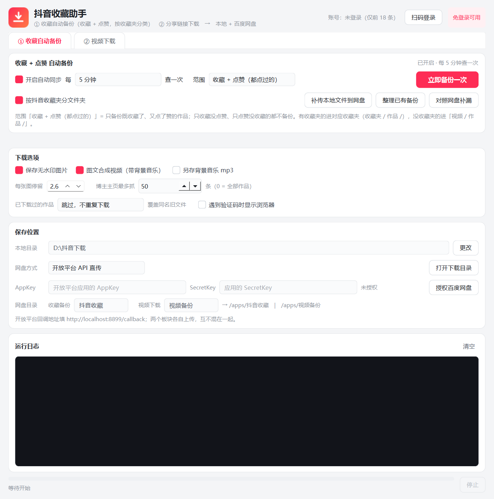
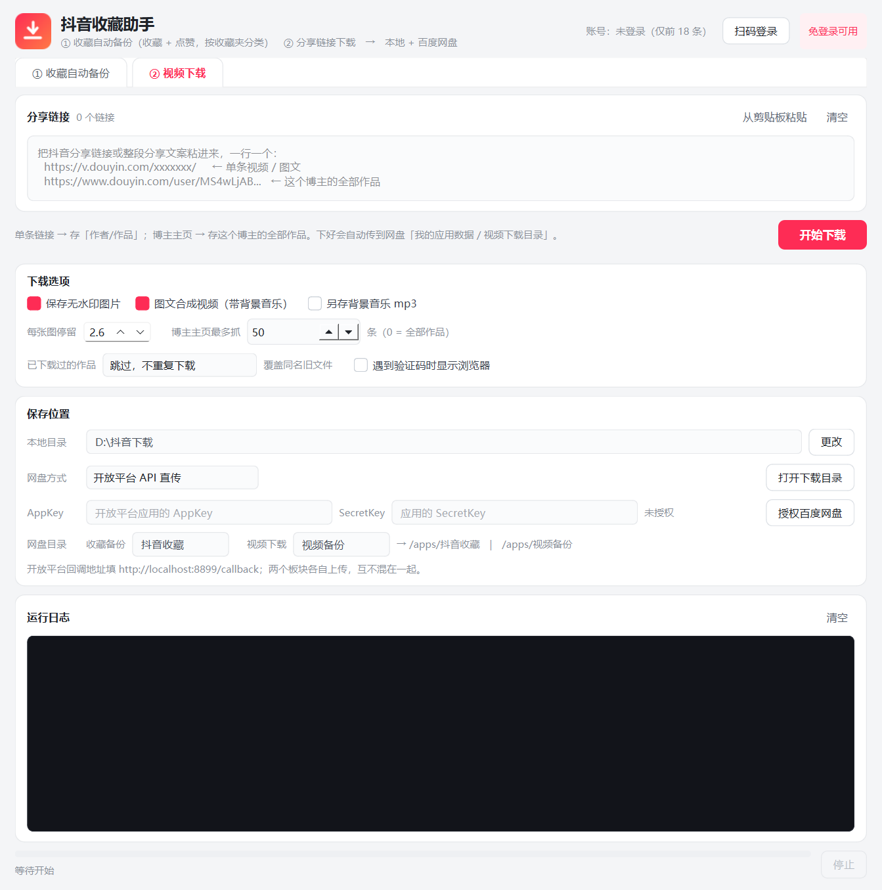

# 抖音收藏助手 · 桌面版

两个板块，一左一右分开用：

| 板块 | 干什么 | 传到网盘哪里 |
|---|---|---|
| **① 收藏自动备份** | 默认只备份**既收藏又点赞**的作品（交集），直接按抖音收藏夹分文件夹（`收藏夹/作品`，不再套作者）；没归夹的统一进「视频」 | 我的应用数据 / **抖音收藏** |
| **② 视频下载** | 粘**分享链接**，下单条视频 / 图文，或者某个博主的全部作品 | 我的应用数据 / **视频备份** |

双击 `抖音收藏助手\DouyinSaver.exe` 就能用，不需要装 Python、不需要命令行。
第一次启动约 2~3 秒，之后基本是秒开。

> exe 名字是英文的 `DouyinSaver`，这是故意的：经过实测，**中文名的 exe 会让它启动卡死**（窗口一直不出来），
> 所以改成了英文文件名，窗口标题和图标仍然是中文的「抖音收藏助手」。

> 实测结论：**下载不需要登录抖音**。程序用你系统里的 Edge 打开页面，截获页面自己发出的数据请求，
> 拿到无水印播放地址和原图。只有「收藏夹」和「博主主页翻页」这两件事需要扫码登录一次。

## 界面

```
┌────────────────────────────────────────────────────────────┐
│  [icon] 抖音收藏助手            账号：已登录  [扫码登录]     │
├────────────────────────────────────────────────────────────┤
│  ┃① 收藏自动备份┃ ② 视频下载                               │
├────────────────────────────────────────────────────────────┤
│  收藏 + 点赞 自动备份                            已开启     │
│  ☑开启自动同步 每[5 分钟▾]查一次 范围[收藏 + 点赞▾] [立即备份一次]│
│  ☑按抖音收藏夹分文件夹      [补传本地文件到网盘] [整理已有备份]│
│  手机点收藏 → 电脑到点自动查 → 收藏夹/作品 → 传网盘…       │
├────────────────────────────────────────────────────────────┤
│  下载选项（两个板块通用）                                   │
│  ☑保存无水印图片  ☑图文合成视频(带背景音乐) ☑另存mp3        │
│  每张图停留[2.6]秒  博主主页最多抓[全部]条                   │
│  已下载过的作品[跳过▾]  ☐遇到验证码时显示浏览器              │
├────────────────────────────────────────────────────────────┤
│  保存位置                                                   │
│  本地目录  D:\抖音下载                             [更改]    │
│  网盘方式  [开放平台 API 直传▾]                  [打开目录]  │
│  AppKey[····] SecretKey[····] 已授权  [重新授权]             │
│  网盘目录  收藏备份[抖音收藏] 视频下载[视频备份]              │
│            → /apps/抖音收藏 | /apps/视频备份                 │
├────────────────────────────────────────────────────────────┤
│  运行日志                                                   │
├────────────────────────────────────────────────────────────┤
│  ▓▓▓▓▓▓▓░░░░  3/7 · 作者 · 标题                    [停止]   │
└────────────────────────────────────────────────────────────┘
```

实际界面（点击看大图）：

| ① 收藏自动备份 | ② 视频下载 |
|---|---|
|  |  |

## 板块一：收藏自动备份

在手机上刷抖音，看到喜欢的就点「收藏」（或点赞）。电脑开着软件，到点自动完成：
**查收藏/点赞 → 有新作品就下载 / 合成带背景音乐的图文视频 → 按收藏夹存好 → 传百度网盘「抖音收藏」**。

```
手机点收藏  →  电脑每 N 分钟查一次  →  比对已备份的 ID  →  只下新的
                                      →  视频直下 / 图文合成 mp4
                                      →  上传到网盘 我的应用数据/抖音收藏/<收藏夹>/<作品>/
```

要点：

1. 先在右上角点一次 **扫码登录**（收藏夹属于你自己的账号，必须登录）
2. 勾上「开启自动同步」，选间隔（5~180 分钟）和范围：
   - **收藏 + 点赞（都点过的）**（默认）：**交集** —— 只备份既收藏了、又点了赞的作品；
     只收藏没点赞的、只点赞没收藏的，都不备份
   - **只备份收藏**：只要收藏了的都备份，严格按抖音收藏夹分类
   - **只备份点赞**：只备份「喜欢」，本来在某个收藏夹里的归到那个收藏夹，其余放「视频」
3. **按抖音收藏夹分文件夹**（默认开）：抖音里建了「古风」「AIGC」「健身」等收藏夹，
   备份就长这样——收藏夹名和抖音里**完全一致**：

   ```
   downloads/                        （网盘 /apps/抖音收藏 下同样结构）
   ├── 古风/                         ← 收藏夹名，和抖音里完全一致
   │   └── 20230810_山不让尘 川不辞盈_486627/
   │       ├── 20230810_山不让尘 川不辞盈_486627.mp4
   │       └── 01.jpg
   ├── AIGC/
   │   └── 20240102_标题_654321/
   └── 视频/                         ← 收藏/点赞了，但没归到任何收藏夹
       └── 20240103_标题_789012/
   ```

   注意：**收藏板块不再套作者层**，作品直接挂在收藏夹下面（`收藏夹/作品/`）。
   不勾「按抖音收藏夹分文件夹」就还是 `作者/作品/` 结构。
4. **「整理已有备份」按钮**：之前已经下好的作品，按抖音收藏夹重新分文件夹，
   并把老结构 `收藏夹/作者/作品` 拍平一层。只移动文件、不重新下载、不删除；
   网盘同步文件夹里的文件也一起整理。下载板块的 `作者/作品` 不会被误搬。
   扫到的「作品 → 收藏夹」对应关系会记 3 天，这几天内再点整理是秒完成的。
5. **「补传本地文件到网盘」**：本地已经下好、但网盘上还没有的文件，补传到「抖音收藏」。
   从老版本升级过来第一次建议点一次，把以前的备份补上去。
6. **「对照网盘补漏」**：把每个收藏夹翻到底，跟网盘上已有的作品一一对账，缺什么补什么
   —— 网盘上被误删、上次传一半断掉、换电脑后本地没有的，都能补齐。

   判断依据是两处：网盘上有没有这个作品的目录、本地 `.downloaded.json` 账本记没记过。
   注意**删掉备份文件不会让账本清零**，所以「删了重下」得先把账本改名（见下文常见问题）。
7. 窗口关掉会缩到右下角托盘继续跑，右键托盘图标可以「打开主窗口 / 立即同步 / 退出」
8. 电脑关机期间的收藏不会丢，下次开机按作品 ID 补下，已备份的不会重下

> 每次自动检查只取每个收藏夹的最新一页（约 10 条），几十秒跑完，足够覆盖手机上刚点的新收藏；
> 要连历史一起重扫（比如整理旧备份），会花几分钟把每个收藏夹翻到底。
> 同一个作品只会在第一个收藏夹里存一份，不会重复占空间。

> 手机跑不了这个程序，实际下载和上传都在电脑上做，所以电脑需要开机、软件需要常驻。

## 板块二：视频下载

1. 抖音里点分享 → 复制链接，切到「② 视频下载」，粘进输入框（一行一个，整段分享文案也行）
2. 点「开始下载」。下完文件在「本地目录」，配了网盘的话会自动进「视频备份」

想抓某个博主的全部作品，把**主页链接**粘进去（`https://www.douyin.com/user/MS4wLjAB...`），
再用「博主主页最多抓 [全部] 条」控制数量。

```
单条链接   → 本地/网盘  <作者>/<作品>/          网盘 /apps/视频备份/<作者>/<作品>/
博主主页   → 同上，这个博主的全部作品
```

> ⚠️ **博主主页有个登录墙**：抖音网页端未登录时，主页只返回前 **18** 条作品，翻页请求会返回空。
> 想抓全（比如 69 条），点右上角 **扫码登录**，用抖音 App 扫一次码即可；
> 登录态存在本机 `.browser` 目录，之后不用再扫。单条视频 / 单篇图文始终不需要登录。

**全程后台运行**：下载、解析、合成都在后台静默执行，不会弹出命令行黑窗口。
只有勾了「遇到验证码时显示浏览器」才会看到浏览器窗口。

## 接百度网盘（开放平台直传，不用装客户端）

一次性配置，大约 5 分钟：

1. 打开 <https://pan.baidu.com/union>，用**要存文件的那个百度账号**登录
2. 完成「个人开发者」实名认证：身份证号 + 手机 + 邮箱，**即时通过**
3. 控制台 → 创建应用：
   - 应用用途选 **个人使用**（免审核，直接上线，限 10 个用户）
   - 应用类型选 **软件**
4. 应用详情 → **安全设置** → 授权回调地址填 `http://localhost:8899/callback`
5. 回到软件：网盘方式选「开放平台 API 直传」，填 AppKey + SecretKey，
   网盘目录保持默认的 `抖音收藏` / `视频备份`
6. 点 **授权百度网盘** → 浏览器里登录并点「授权」→ 回到软件显示「已授权」

之后文件会自动传到：

```
我的应用数据/
├── 抖音收藏/             ← 板块一（收藏 + 点赞）
│   ├── 古风/
│   │   └── 20240101_标题_123456/{图片, 背景音乐, 合成视频}
│   └── 视频/                        ← 没归到收藏夹的
│       └── 20240103_标题_789012/…
└── 视频备份/             ← 板块二（分享链接 / 博主主页）
    └── 作者昵称/20261013_标题_666745/{01.jpg, 背景音乐.mp3, 视频.mp4}
```

几点说明：

- 两个板块各传各的目录，互不混在一起；两个目录名都能在界面上改
- access_token 有效期 30 天，程序会在到期前**自动续期**，不用管
- 不想用直传就切回「同步文件夹」（文件位置随意，但要电脑常开百度网盘客户端）
- 单文件上限：普通用户 4GB / 会员 10GB，抖音视频远小于这个

## 产物长什么样（本地）

**一个作品 = 一个文件夹**，文件夹里只放你勾选的那几样东西：

```
本地目录/
├── 古风/                                     # 收藏板块：收藏夹/作品
│   └── 20240101_标题_123456/…
└── 作者昵称/                                 # 下载板块：作者/作品
    ├── 20260926_标题_564658/                 # 视频作品
    │   ├── 20260926_标题_564658.mp4          # 无水印视频（h264）
    │   └── 20260926_标题_564658.mp3          # 原声（勾了「另存背景音乐」才有）
    └── 20250209_标题_322899/                 # 图文作品
        ├── 01.jpg  02.jpg  …                 # 无水印原图（勾了「保存无水印图片」才有）
        ├── 背景音乐.mp3                       # （勾了「另存背景音乐」才有）
        └── 20250209_标题_322899.mp4          # 图片+音乐合成视频（勾了「图文合成视频」才有）
```

三个选项全勾 → 文件夹里就是「mp4 + 原图 + 背景音乐」三样齐全；只勾合成视频 →
文件夹里只有一个 mp4，不会塞一堆你不要的图片和音频。

> 图集里的**实况/动态图**会下成 `NN_动态.mp4`，合成视频时按它的自然时长插进去
> （静态图照样轮播），不再是冻住的一帧；实况拿不到时自动退回静态图。

> 老版本把 mp4/mp3 散放在作者目录下，新版本启动时会自动把散落的文件收进各自的
> 作品文件夹（纯移动，不删东西）。

下过的作品记在 `.downloaded.json`，再跑一次只补新的（增量追更）。

### 碰到下过的作品怎么处理

「已下载过的作品」三选一，默认**跳过**：

| 选项 | 行为 | 什么时候用 |
|---|---|---|
| 跳过，不重复下载 | 命中 `.downloaded.json` 里的作品 ID 就跳过，日志里显示「跳过（已下过）」 | 日常追更，最省时间 |
| 重新下载并覆盖 | 删掉同名旧文件，重新拉一遍图片/视频并重新合成 | 想换清晰度、修以前的旧文件 |
| 每条都问一下我 | 每条弹窗，可选「重新下载 / 跳过这条 / 后面全部重新下载 / 后面全部跳过」 | 只想挑几条重下 |

另外两种情况会自动重下，不受这个选项影响：
- 记录里有、但文件被删了/移走了 → 自动补下
- 图文合成视频缺音轨，或比背景音乐短（旧版本截断问题）→ 自动重新合成

## 三种网盘方式怎么选

| 方式 | 文件落点 | 前提 | 适合 |
|---|---|---|---|
| **开放平台 API 直传** | 我的应用数据 / 抖音收藏、视频备份 | 实名认证建应用（5 分钟，免费） | 想全自动、不装客户端 |
| 同步文件夹 | 你自己指定的任意网盘目录 | 电脑装百度网盘客户端，同步空间可能要超级会员 | 想让文件放网盘根目录 |
| 仅存本地 | 不下发网盘 | 无 | 只想存电脑里 |

> 早期版本的说明里写过「开放平台个人认证已暂停」，那是**过时信息**。
> 2026 年个人开发者实名认证即时通过，可建 2 个应用，用途选「个人使用」还免审核。

## 从源码运行 / 重新打包

```bash
# 0. 准备环境（Python 3.11+）
python -m venv .venv
.venv\Scripts\pip install -r requirements.txt
.venv\Scripts\python -m playwright install chromium   # 只用系统 Edge/Chrome 的话可跳过
copy config.example.json config.json                  # 首次运行，再按需填百度网盘凭据

# 1. 跑起来
start.bat                                    # 源码启动界面（无控制台窗口）
.venv\Scripts\python.exe app.py              # 源码启动界面（有控制台，便于看报错）
.venv\Scripts\python.exe cli.py "链接"        # 命令行版（批量、脚本化更顺手）

# 2. 重新打包成 exe
.venv\Scripts\pyinstaller.exe DouyinSaver.spec --noconfirm --clean
```

**必须是文件夹模式（不加 `--onefile`），exe 名必须是英文**，这两条是踩过坑换来的：

- `--onefile`：单文件每次启动要先解 300MB 到临时目录，被安全软件逐个扫描，实测启动要 **30 秒**，看着就像"双击没反应"
- 中文 exe 名：进程能起来，但窗口永远不出来，约 10 秒后静默崩溃（系统日志里是 `ucrtbase.dll` 的 `0xc0000409`）

打完把 `dist/DouyinSaver` 整个文件夹（约 300 MB，含 Qt + playwright 驱动 + ffmpeg）拷走即可。
如果双击真没反应，看同目录下的 `启动错误.log`。

打包产物自检（不显示界面，只检查依赖是否齐）：

```bash
dist\DouyinSaver\DouyinSaver.exe --selftest    # 12 项依赖检查，结果写 selftest.log
dist\DouyinSaver\DouyinSaver.exe --smoke       # 真起一次窗口并截图，结果写 smoke.log
```

## 图文合成的时长逻辑（与抖音对齐）

抖音里图文作品的时长就是**背景音乐的时长**，不是"图片数 × 固定秒数"。所以合成时按这个规则：

| 情况 | 处理 |
|---|---|
| 音乐比一轮图片长 | 图片循环轮播，铺满音乐，**音乐完整放完才结束** |
| 音乐比一轮图片短 | 按音乐节奏压缩每张停留时间，图和音乐同时结束 |
| 没有背景音乐 | 按「图片数 × 每张停留」出片 |

**实况 / 动态图**（`live_photo_type=1` 的实况图、`clip_type=3` 的 GIF 动图）单独处理：
第 1 轮按小视频的自然时长播放，**之后定格它的最后一帧**，不再跟着轮次反复抖动 ——
否则一张 0.7 秒的动图配上 150 秒的音乐，会被循环两百多次。

「每张图停留」默认 2.6 秒，可在界面上调（0.8–10 秒）。旧版本合成出来的视频如果比音乐短，重新跑同一条链接会自动检测并重做。

> 实现细节：轮数多时先把「一轮」渲成临时片，再用 `-stream_loop` 循环，
> 命令行长度只跟图片张数有关，跟轮数无关（否则长音乐会撑爆 Windows 命令行，报 `WinError 206`）。

## 关于声音

- **合成出来的视频一定带背景音乐**，和「另存背景音乐 mp3」这个勾选无关 —— 那个勾选只决定要不要单独留一份音频文件。
- 音乐来源有两路：先是接口直链，拿不到（版权音乐）就从作品页播放流里截，所以个别作品会多等几秒。
- 保存的音频后缀按真实格式走：抖音有些地址结尾是 `.mp3`，实际是 m4a 容器，会自动改成 `.m4a`。

## 已知限制

- 主页作品要靠滚动触发分页，几千条的超大号会慢，建议分批。
- 抖音偶尔弹验证码，勾上「遇到验证码时显示浏览器」手动过一次即可。
- 收藏夹有 60 多个时，全量扫描约 5 分钟；个别卡片抖音不给翻页，只能拿到首屏（日志会写明）。
- 无声图文（抖音里那类纯图无 BGM 的作品）按「图片数 × 每张停留」出片；有声图文一律以音乐时长为总时长。
- 版权音乐的接口直链是空的，程序会从作品页播放流里再抓一次（多等几秒）。极少数作品仍可能抓不到，日志会写明。
- 下载给自己收藏用，别公开二次分发。

## 开发与测试

```bash
.venv\Scripts\python.exe tests\test_url_refresh.py   # 离线，随时可跑（模拟 403 换新地址）
.venv\Scripts\python.exe tests\test_live_photo.py    # 实况动图识别 + 定格合成（联网，需登录）
```

`tests/` 里是开发期的手动验证脚本，清单和登录态说明见 [tests/README.md](tests/README.md)；
`tools/` 是运维脚本（批量重合成旧成片、按收藏夹整理、跑一次真实同步），用法见各文件开头的 docstring。

## 项目结构

```
.
├── app.py                 桌面界面（PySide6，两个板块用 QTabWidget 分开）
├── cli.py                 命令行入口 / 交互模式 / 配置向导
├── core/
│   ├── config.py          配置读写、默认值合并
│   ├── linkparse.py       分享文案、短链、各种 URL → 作品/作者标识
│   ├── douyin.py          浏览器截获抖音接口（收藏夹 / 点赞 / 主页）
│   ├── downloader.py      无水印地址挑选、下载、图集合成视频（含实况定格）
│   ├── pipeline.py        落盘 + 去重 + 按收藏夹分类 + 上传网盘 + 对账补漏
│   └── baidu.py           百度网盘开放平台（授权、上传、移动、列目录）
├── assets/icon.ico        程序图标
├── tests/                 开发期验证脚本（多为联网 + 需登录，见 tests/README.md）
├── tools/
│   ├── repair.py          批量重合成「视频比音乐短」的旧图文成片
│   ├── run_reclass.py     对真实安装目录跑一次「按收藏夹整理」
│   └── run_sync_real.py   对真实安装目录跑一次「收藏 + 点赞」同步
├── docs/                  界面截图
├── DouyinSaver.spec       PyInstaller 打包配置
├── requirements.txt       运行依赖
├── config.example.json    配置模板（不含任何凭据）
├── start.bat              源码方式启动界面（无控制台窗口）
└── 抖音收藏助手/          打包后的运行目录（含 exe / 依赖 / 配置 / 备份数据，不进仓库）
    ├── DouyinSaver.exe
    ├── _internal/         Qt / playwright / ffmpeg 全部依赖
    ├── config.json        运行配置（含网盘凭据）
    └── downloads/         备份下来的作品
```

## 常见问题

**把备份文件（本地和网盘）全删了，重新备份还是显示「跳过」？**
不是 bug。去重只看账本 `downloads/.downloaded.json` 里记过的作品 ID，跟文件在不在无关
（否则一轮同步就会把 5 分钟前刚下过的全部重下一遍）。想彻底重来：

```bash
ren 抖音收藏助手\downloads\.downloaded.json .downloaded.json.bak
```

**日志里出现 403 Forbidden / 404 Not Found？**
抖音的播放地址是带时效签名的，收藏夹翻得多、跑得久就会过期。程序会自动重抓一次作品详情换新地址再下，
同一个地址也不再傻重试 3 次；只有重抓也拿不到时才记为失败，下轮会再试。

**合成图文视频报 `[WinError 206] 文件名或扩展名太长`？**
旧版本把每一轮图片都展开成一套 ffmpeg 输入参数，长音乐（150 秒 / 一轮 0.8 秒 = 200 多轮）会撑爆
Windows 命令行。现在改成先渲一轮再 `-stream_loop` 循环，已经不会触发。

**实况/动态图变成静态图？**
识别以「图集里这一项带 `video.play_addr`」为准，实况图（`live_photo_type=1`）和 GIF 型动图（`clip_type=3`）
都能认出来；合成时首轮按小视频自然时长播放，之后定格最后一帧。
